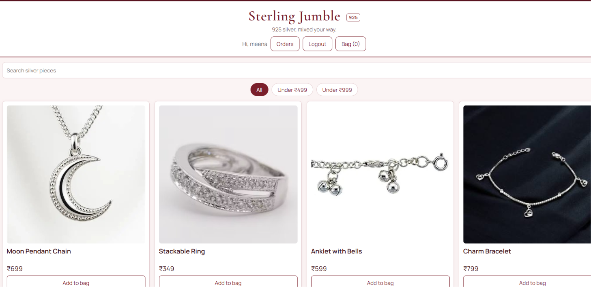
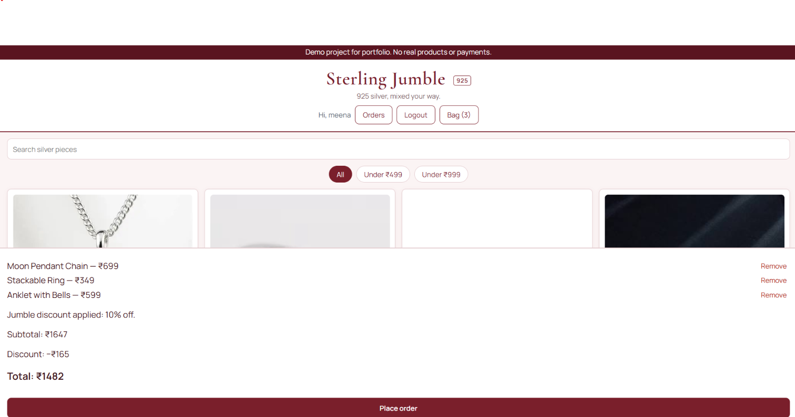
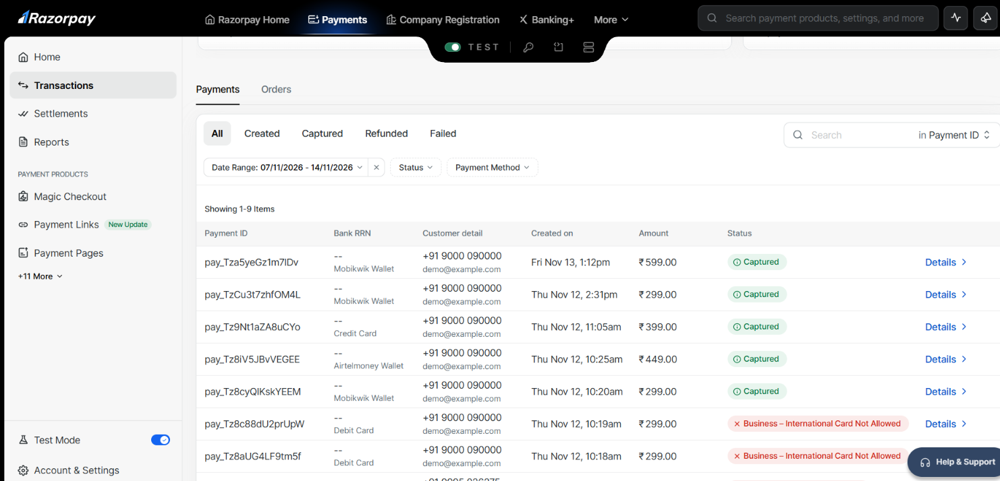
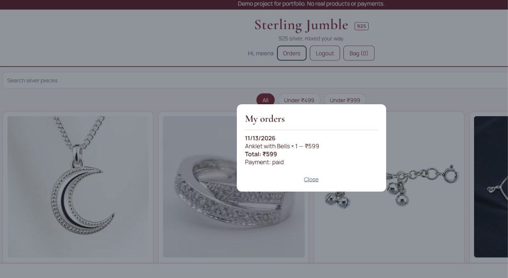

# Sterling Jumble

A full-stack e-commerce web app for a demo 925 sterling silver jewellery store. Built with the MERN stack as a portfolio project.

**Live demo:** https://sterling-jumble.vercel.app/
**API:** https://sterling-jumble.onrender.com/api/products

> **Demo project.** No real products are sold and no real payments are taken. Payments run in Razorpay **test mode** only. Product images are for demonstration purposes only.

> In demo mode the password-reset OTP is shown on screen instead of being emailed, so no real email or phone number is needed. Set `DEMO_MODE=off` and add an email provider for production.

> The API runs on a free hosting tier, so the first request after a period of inactivity can take up to a minute while the server wakes up.

## Screenshots

| Storefront | Bag with bundle discount | Test payment | Order history |
|---|---|---|---|
|  |  |  |  |

## Features

- Product catalogue loaded from MongoDB, with text search and budget filters (under ₹499, under ₹999)
- Shopping bag that persists across page refreshes, with a bundle offer: add 3 or more pieces to get 10% off
- Sign up and log in with JWT authentication and hashed passwords (bcrypt)
- Forgot-password flow with a hashed, 10-minute OTP (max 5 attempts)
- Order placement saved to the database, with prices recalculated on the server (the client's totals are never trusted)
- Order history per user, including payment status
- Razorpay checkout in **test mode**, with server-side payment signature verification (HMAC SHA-256)
- Safety lock: the payment routes refuse to run unless the configured key starts with `rzp_test_`
- Responsive layout, equal-size product cards, maroon theme

## Tech stack

| Layer | Technology |
|---|---|
| Frontend | React (Vite), Context API, plain CSS |
| Backend | Node.js, Express |
| Database | MongoDB Atlas with Mongoose |
| Auth | JSON Web Tokens, bcryptjs |
| Payments | Razorpay (test mode) |
| Hosting | Vercel (client), Render (server) |

## How to try the test payment

1. Sign up with any email and a password of at least 6 characters.
2. Add 3 pieces to the bag and click **Place order**, then **Pay now (test mode)**.
3. In the Razorpay window, confirm it says **Test Mode**.
4. Use a wallet, or a test card from Razorpay's official test card page. Any CVV and any future expiry date work. Never enter a real card or UPI ID.
5. On the mock bank page, click **Success**. The order status changes to **paid** and appears in **My orders**.

## Run it locally

Requirements: Node.js, a free MongoDB Atlas cluster, and Razorpay **test** keys.

```bash
git clone https://github.com/vaishnavibt123-droid/sterling-jumble.git
cd sterling-jumble

# server
cd server
npm install
# create server/.env (see below), then:
node seed.js      # loads the sample products
npm run dev       # http://localhost:5000

# client (in a second terminal)
cd client
npm install
npm run dev       # http://localhost:5173
```

`server/.env` (names only, never commit real values):

```
MONGO_URI=
PORT=5000
JWT_SECRET=
RAZORPAY_KEY_ID=rzp_test_...
RAZORPAY_KEY_SECRET=
```

The client reads the API address from `VITE_API_URL` and falls back to `http://localhost:5000/api`.

## Project structure

```
sterling-jumble/
  client/            React app (components, context, styles)
  server/
    models/          Product, User, Order
    routes/          products, auth, orders, payments
    middleware/      JWT auth
    seed.js          sample products
```

## API overview

| Method | Route | Description |
|---|---|---|
| GET | `/api/products` | List products (`q`, `category`, `maxPrice` filters) |
| POST | `/api/auth/register` | Create an account |
| POST | `/api/auth/login` | Log in |
| POST | `/api/orders` | Place an order (auth) |
| GET | `/api/orders` | My orders (auth) |
| POST | `/api/payments/create` | Create a Razorpay test order (auth) |
| POST | `/api/payments/verify` | Verify the payment signature (auth) |

## What I learned

- Designing a REST API with Express and Mongoose, including input validation and safe search handling
- Stateless authentication with JWT and protected routes
- Why the server must recompute order totals and verify payment signatures instead of trusting the browser
- Deploying a split frontend and backend, and handling environment variables and secrets safely

## Possible next steps

- Admin dashboard for managing products and orders
- Payment webhooks for more reliable status updates
- Stock tracking and a product detail page
